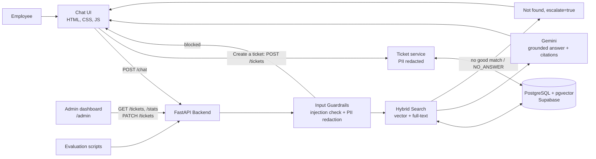

# AI-HAS Architecture

## Components
| Component | Tech | Role |
|---|---|---|
| Backend | FastAPI (Python 3.12) | Routes, RAG orchestration, guardrails, tickets, serves both pages |
| Chat page | HTML, CSS, JS in `frontend/chat/` | Chat, history in the browser, "Create a ticket" button |
| Admin dashboard | HTML, CSS, JS in `frontend/admin/` | Ticket KPIs, list with status filter, status changes |
| Guardrails | `guardrails.py` | Blocks prompt injection and over-long messages, redacts PII before the AI or the database sees it |
| Tickets | `tickets.py` | Create, list, change status, KPI stats |
| Database | PostgreSQL with pgvector on Supabase | KB chunks and vectors, users, tickets (messages, conversations and audit_logs tables are defined but not written yet) |
| LLM | Gemini via OpenAI-compatible endpoint | Embeddings and answers; model names come from `.env` |
| Local test DB | `pgvector/pgvector:pg16`, compose profile `local-db` | Testing without touching Supabase |
| Evaluation | `eval_generate.py`, `eval_run.py` | Retrieval accuracy, deflection, escalation, guardrail and latency report |

Docker compose runs one service, `backend`, plus `db` under the `local-db` profile. There is no ChromaDB and no n8n container.

## Request flow: chat
1. `check_input` blocks messages over 1000 characters and known injection patterns. A blocked message gets a fixed reply and never reaches the AI.
2. `redact_pii` replaces emails, phone numbers, valid card numbers, API keys and passwords with `[REDACTED]`. Only the cleaned text is used from here on.
3. The question is embedded and hybrid search runs over `kb_chunks` (vector distance plus full-text, merged by rank).
4. If the best distance is above 0.5, the API returns the "not found" message with `escalate=true`.
5. Otherwise the closest chunks go to Gemini with a prompt that allows answers only from that context.
6. If the model replies NO_ANSWER, the API returns "not found" with `escalate=true`. Else it returns the answer, citations, distances and what was redacted.

## Request flow: tickets
1. On a not-found answer the chat page shows "Create a ticket". It sends the question (trimmed to 500 characters) to `POST /tickets`.
2. The summary is PII-redacted, then saved with source `escalation`. The ticket belongs to `employee@company.com`, or to the first `employee` user with a logged warning if that user is missing.
3. The page shows the ticket reference (for example `TCK-0002`). The admin dashboard shows it through `GET /tickets` and `GET /stats`.

## Database
Tables: `users`, `conversations`, `messages`, `tickets`, `kb_documents`, `kb_chunks`, `audit_logs`. See `backend/schema.sql`, which must be verified against the real Supabase definition.

Scripts that write data (`init_db`, `ingest`) run only when the `DATABASE_URL` host is `db` or `localhost`, unless `--allow-remote` is passed (`safety.py`). Schema changes must be additive and idempotent.

## Testing
`pytest` runs without Gemini or a real database by stubbing the engine. The evaluation scripts are separate: they call Gemini and the database, and write `backend/app/eval_data/report.md`.

## Not built yet
- n8n workflows and mock Jira or Active Directory actions
- Intent classification and function calling
- Saving conversations, messages and audit logs (tables exist, nothing writes to them)
- Authentication for the admin dashboard and output guardrails on the answer
