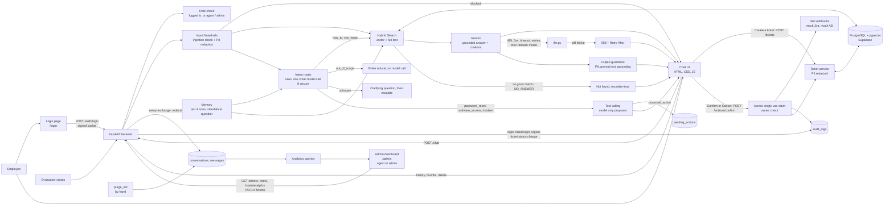

# AI-HAS Architecture

## Components
| Component | Tech | Role |
|---|---|---|
| Backend | FastAPI (Python 3.12) | Routes, RAG orchestration, guardrails, tickets, serves both pages |
| Chat page | HTML, CSS, JS in `frontend/chat/` | Chat with Orbie (the assistant's name; AI-HAS is the product), history in the browser, "Create a ticket" button |
| Login page | HTML, CSS, JS in `frontend/login/` | Sign in, same look as the chat. `chat/session.js` shows the user and Log out, and sends a logged-out visitor to the login page |
| Admin dashboard | HTML, CSS, JS in `frontend/admin/` | Ticket KPIs, list with status filter, status changes. Agent or admin only |
| Authentication | `auth.py`, `sessions.py`, `passwords.py`, `loginlimit.py`, `set_password.py` | PBKDF2 password hashes (standard library), signed `HttpOnly`, `SameSite=Lax` session cookie, role checks as FastAPI dependencies, failed login limits, a hidden-prompt helper to set passwords |
| Chat history | `chatlog.py` | Saves each exchange (redacted text, citations, confidence, latency, intent, outcome, flags), lists, reads and deletes conversations, stores thumbs. Failures never stop an answer |
| Analytics | `analytics.py`, `GET /stats/analytics` | Questions per day, deflection rate, median and p95 latency, thumbs share, top cited articles, most escalated questions. Staff only |
| Knowledge base page | `kb.py`, `ingest.py`, HTML, CSS, JS in `frontend/kb/` | Admin-only list, markdown editor, save with re-index of one article, delete and a retrieval test box. The script and the page share `ingest.prepare_article` and `ingest.store_article`. Changes need a local database unless `KB_EDIT_ALLOW_REMOTE` is true |
| Retention | `purge_old.py` | Replaces old message text and conversation titles with `[purged]`, keeps the numbers. Local database unless `--allow-remote` |
| Audit | `audit.py` | One place that writes `audit_logs` rows without personal data |
| Rate limit and security | `ratelimit.py`, middleware in `main.py` | Per-IP rate limits on `/chat` and `/tickets`, security headers on every response, generic 500 for unhandled errors |
| Guardrails | `guardrails.py` | Blocks prompt injection and over-long messages, redacts PII before the AI or the database sees it |
| Tickets | `tickets.py` | Create, list, change status, KPI stats, save the Jira key |
| Actions | `actions.py` | Calls the n8n webhooks (5 second timeout, optional secret header, clear errors). Creates the local ticket first, so a Jira outage leaves it pending |
| Proposals | `proposals.py` | Validates and stores what the model proposed, confirms or cancels it atomically for its owner, writes `audit_logs` |
| Intent routing | `intent.py`, the route in `main.py` | Rules in English and Taglish decide the intent. One small single-attempt model call only when they are unsure. Routes: RAG, an action proposal, a refusal, or a clarifying question that escalates on the second miss |
| Memory | `memory.py`, `chatlog.recent_turns` | The last 4 exchanges of the saved conversation for the answer prompt, and a rules-built standalone question for the search |
| Output guardrails | `guardrails.check_output`, called from `rag.answer` | Replaces an answer with PII, a password, a key or prompt text. Sends an unsupported answer to not found |
| Tool calling | `rag.py` (`propose_action`) | For an action intent, one model call with only that intent's tool fills in the arguments. The model can only propose. Rule-built proposal if the call fails or is malformed |
| n8n | `n8nio/n8n`, compose profile `n8n`, `n8n/*.json` | Mock Jira key and mock Active Directory reset. Published on 127.0.0.1:5678 only |
| Database | PostgreSQL with pgvector on Supabase | KB chunks and vectors, users, tickets, `pending_actions`, `audit_logs`, and the saved `conversations` and `messages` |
| LLM | Gemini via OpenAI-compatible endpoint | Embeddings and answers; model names come from `.env` |
| Provider calls | `llm.py` | Every chat and embedding call: a timeout per attempt, a total budget, up to 2 retries (1 s, 3 s) on timeouts, 429 and 5xx, an optional one-shot fallback model, and a fixed `ProviderUnavailable` that becomes HTTP 503 with `Retry-After`. Logs model, kind, status and error class only |
| Local test DB | `pgvector/pgvector:pg16`, compose profile `local-db` | Testing without touching Supabase |
| Evaluation | `eval_run.py`, `eval_judge.py`, `eval_metrics.py`, `eval_report.py`, `eval_generate.py` | Generated and hand-written hard question sets, retrieval accuracy, deflection, escalation, guardrails, LLM-judged faithfulness and relevance, MAX_DISTANCE sweep, retries and resumable runs |
| Load test | `loadtest.py` | Requests per second, error rate and latency percentiles for `POST /chat`, in mock, retrieval-only or full mode |

Docker compose runs one service, `backend`, plus `db` under the `local-db` profile and `n8n` under the `n8n` profile. There is no ChromaDB.

## Request flow: chat
0. Every request first passes the middleware (security headers, generic 500 on unhandled errors). `POST /chat` and `POST /tickets` also pass the per-IP rate limit and get 429 when over it.
1. `check_input` blocks messages over 1000 characters and known injection patterns. A blocked message gets a fixed reply and never reaches the AI.
2. `redact_pii` replaces emails, phone numbers, valid card numbers, API keys and passwords with `[REDACTED]`. Only the cleaned text is used from here on.
3. The question is embedded and hybrid search runs over `kb_chunks` (vector distance plus full-text, merged by rank).
4. If the best distance is above 0.5, the API returns the "not found" message with `escalate=true`.
5. Otherwise the closest chunks go to Gemini with a prompt that allows answers only from that context. If Gemini fails after its retries (and the fallback model, if one is set), the request ends with HTTP 503 and the chat page offers Try again.
6. If the model replies NO_ANSWER, the API returns "not found" with `escalate=true`. Else it returns the answer, citations, distances and what was redacted.

## Request flow: login and roles
1. `POST /auth/login` checks the failed-login limits (per email and per IP), then the password hash. An unknown email is checked against a dummy hash, so it costs the same. Every outcome writes an audit row (`login`, `login_failed`).
2. On success the answer sets the cookie `aihas_session`: a token `payload.signature` where the payload is `{uid, iat, exp}` and the signature is HMAC-SHA256 with `SESSION_SECRET`. The cookie is `HttpOnly`, `SameSite=Lax`, and `Secure` when `COOKIE_SECURE=true`. Login is refused (503) while the secret is missing or shorter than 32 characters.
3. On every request `current_user` verifies the signature and expiry, then reads the user and role from the database. `require_roles("agent", "admin")` builds on it: no session is 401, the wrong role is 403.
4. Pages: a logged-out `/` or `/admin` redirects to `/login` (the `next` value must be a local path), and an employee opening `/admin` gets a 403 page.
5. A middleware rejects any POST, PATCH or DELETE that is not JSON (415) or that carries a foreign `Origin` (403). Together with `SameSite=Lax` and no CORS, this blocks simple cross-site form posts.
6. Logout clears the cookie and writes a `logout` row. The token is stateless, so a copy stays valid until it expires.

## Request flow: knowledge base page
1. `/admin/kb` and every `/kb` route need the `admin` role: 401 when logged out (the page redirects to the login), 403 for an agent or an employee.
2. `PUT /kb/{source}` checks the name (lowercase letters, digits, dashes, `.md`, not a reserved name), the path (directly inside the KB folder, no symlink), the size (`KB_MAX_BYTES`) and the heading, and refuses to change anything unless the database is local or `KB_EDIT_ALLOW_REMOTE` is true.
3. The article is chunked and embedded first, through `llm.py` in batches of 50. If that fails nothing has changed (503 with `Retry-After`).
4. A temp file is written, then one transaction replaces the article's `kb_documents` and `kb_chunks` rows and writes the `kb_create` or `kb_update` audit row (file name only), and only then is the file moved into place. If the transaction fails the temp file is removed and the old article is untouched.
5. `DELETE /kb/{source}` removes the rows and the audit row in one transaction, then the file. `GET /kb` compares the folder with the index and marks each article `indexed`, `not_indexed` or `file_missing`.
6. `POST /kb/test` runs `rag.retrieve` (one embedding call) and returns the chunks and distances. It never calls the answer step.

## Request flow: saving a chat
1. `POST /chat` may carry a `conversation_id`. It must be one of the caller's own conversations, otherwise 404 before anything runs (not even staff can write into another user's chat).
2. The pipeline runs as before, on the redacted text. Then the user message and the assistant message are written in one transaction, creating the conversation (with a title from the first question) when there is none. The assistant row holds the citations, the confidence from the best distance, the whole request time, the intent and the `escalated` and `blocked` flags.
3. A blocked message is saved as `[blocked message]` with `blocked = true`. A proposed action is saved as intent `action_proposed` without its id, and the pending action is linked to the conversation so a ticket made from it joins the chat.
4. A ticket created from the chat (`POST /tickets` with a `conversation_id`, or a confirmed action) is linked through `tickets.conversation_id`, and the conversation becomes `escalated`.
5. If any database step fails, the answer is still returned with `conversation_id: null`. `PERSIST_CHATS=false` skips all of this.
6. The chat page sends the conversation id back with each question, rates answers through `PATCH /messages/{id}/feedback`, and loads its history from `GET /conversations`, falling back to the browser history.
7. `GET /conversations/{id}` is for the owner, or for staff (audited as `conversation_read`). `DELETE /conversations/{id}` is for the owner only and unlinks its tickets.

## Request flow: a provider failure
1. `rag.answer` and `rag.retrieve` call `llm.chat` and `llm.embeddings`. Each attempt gets a timeout (`CHAT_TIMEOUT_SECONDS` or `EMBED_TIMEOUT_SECONDS`, cut to the time left in `LLM_CALL_BUDGET_SECONDS`).
2. A timeout, connection error, 429 or 500 to 504 is retried after 1 s and then 3 s. 400, 401, 403, 404 and a daily-quota 429 are not retried on the same model.
3. If the main model still fails with 404, 429, 5xx or a timeout and `CHAT_MODEL_FALLBACK` is set, that model gets one attempt (at least 10 s). Embeddings have no fallback.
4. If nothing worked, `ProviderUnavailable` is raised with a fixed message and no attached error. An app-level handler turns it into 503, `Retry-After: 10` and the busy message. Nothing is saved for that question.
5. The log has one line per failed attempt (model, kind, status, error class, attempt number), never the error text, body, URL or key.
6. The chat page shows the message with a Try again button that waits out the `Retry-After`, then resends the same question without adding a second copy of it.
7. The intent classifier and the action tool call are single attempts, with the rules as plan B. The evaluation runner stops after repeated provider failures and resumes with `--resume`.

## Request flow: intent routing
1. The recent turns of the saved conversation are read from the server (redacted text, the caller's own conversation only). A short or pointing follow-up with no IT topic becomes a standalone question by rules.
2. `intent.classify` runs the rules. If they are confident (0.75 and no second intent that fits), that is the answer, with no model call. Otherwise one small JSON classifier call is made (single attempt), and if it fails the rules' guess for a knowledge base question, or `how_to`, is used.
3. `how_to` and `vpn_issue` search with the standalone question and answer from the knowledge base, with the earlier turns in the prompt. `out_of_scope` returns a refusal. `unknown` asks one clarifying question and escalates if the next message is still unclear. An action intent goes to the action flow below.
4. The model's answer passes `check_output` before it is returned: replaced if it holds PII, a password, a key or prompt text, sent to not found if no step is supported by the retrieved text. The response and the saved message carry the intent, and the saved message carries the outcome.

## Request flow: actions
1. For `password_reset`, `software_access` and `incident`, one model call with only that intent's tool fills in the arguments (a single attempt). A ticket for an incident is always high priority.
2. If the model calls the tool (or the proposal is built by rule because the call failed or was malformed), the arguments are validated and redacted and stored in `pending_actions` with an unguessable id, the owner and a 10 minute expiry. `/chat` returns `proposed_action` and no knowledge base answer. Nothing has run.
3. The chat page shows Confirm and Cancel. `POST /actions/confirm` sends only the id.
4. One `UPDATE ... WHERE id AND owner AND status = 'pending' AND not expired` claims the proposal. Row count 1 means this call owns it. Otherwise the answer is 403 (other owner), 404, 409 (already handled) or 410 (expired).
5. A confirmed ticket is saved locally, then n8n returns a Jira key stored in `tickets.external_ref`. If n8n is down the ticket stays and the Jira sync is reported as pending. A password reset needs n8n and reports a clear error without it.
6. An `audit_logs` row is written for every confirm and cancel: actor `user:<id>`, action, and a payload with decision and outcome but no email, name or ticket text.

## Request flow: tickets
1. On a not-found answer the chat page shows "Create a ticket". It sends the question (trimmed to 500 characters) to `POST /tickets`.
2. The summary is PII-redacted, then saved with source `escalation`. The ticket belongs to the logged-in user.
3. The page shows the ticket reference (for example `TCK-0002`). The admin dashboard shows it through `GET /tickets` and `GET /stats`, together with the Jira-style key (`external_ref`, for example `HELP-4821`) once n8n has returned one, and a dash until then.

## Time
Stored times are UTC in `timestamp without time zone` columns. `timeutil.as_utc` marks them as UTC where they leave the API, so the JSON carries `+00:00`, and the browser shows them in the viewer's local time. `?tz=` (validated against `pg_timezone_names`, passed only as a bound parameter) moves the day boundaries of `/stats` and `/stats/analytics` to the viewer's zone. The UTC assumption is documented in the README, with a check for Supabase.

## Database
Tables (`users` has `password_hash`, `conversations` has `title`, `messages` has `feedback`, `escalated` and `blocked`): `users`, `conversations`, `messages`, `tickets`, `kb_documents`, `kb_chunks`, `audit_logs`, `pending_actions` (new, additive, to be reviewed by the team lead before it is applied to Supabase). See `backend/schema.sql`, which must be verified against the real Supabase definition.

Scripts that write data (`init_db`, `ingest`) run only when the `DATABASE_URL` host is `db` or `localhost`, unless `--allow-remote` is passed (`safety.py`). Schema changes must be additive and idempotent.

## Testing and CI
`pytest` runs without Gemini or a real database by stubbing the engine. The chat saving, conversation and purge tests use in-memory fakes of the tables; the analytics SQL was also run against seeded rows in the local Postgres. Tests that need a user use the `login_as(role)` fixture, and the login tests use an in-memory fake of `users` and `audit_logs` with real signed cookies. The action tests use a fake n8n (a stand-in for `httpx.post`), a fake model client and an in-memory fake of `pending_actions` and `audit_logs`. GitHub Actions runs ruff, pytest and a backend `docker build` on every pull request and on pushes to `main`, with no secrets. The check is advisory unless branch protection is enabled on `main`. The evaluation scripts are separate: they call Gemini and the database, and write `backend/app/eval_data/report.md`. Their helpers (scoring, judge JSON parsing, sweep, report text, load test statistics) are covered by tests that use fake data.

## Not built yet
- Real Jira and Active Directory (the n8n workflows are mocks)
- Intent rules for more languages than English and Taglish, and a model-written rewrite for follow-ups the rules cannot make standalone
- Copying the old browser-only history to the server, a list of all conversations for staff, and automatic retention
- Password reset by email, changing your own password in the UI, token revocation (logout only clears the cookie), two-factor login, and different rights for agent and admin
- Output guardrails on the answer

## Evaluation flow
1. For each question, `retrieve` embeds it and runs hybrid search (1 embedding call). The best distance is kept, because the threshold sweep reuses it.
2. `answer(question, chunks)` reuses those chunks, so the question is not searched twice. If the best distance is above `MAX_DISTANCE` it escalates, otherwise it calls the chat model once.
3. For an answered question, the judge makes two separate calls: faithfulness (sees the context the model was given) and relevance (sees only the question and answer). Each returns strict JSON; unusable replies are counted and left out of the averages.
4. Guardrail cases (injection, PII, harmless messages) run locally with no API calls.
5. The sweep counts, for each `MAX_DISTANCE` from 0.30 to 0.70, in-scope questions that would be wrongly escalated and out-of-scope questions that would be wrongly answered, and recommends the middle of the flat stretch with the fewest errors.
6. Results are saved to `eval_data/.cache` one by one, and `eval_data/report.md` is built from them. The load test keeps its own marked section in the same file.
