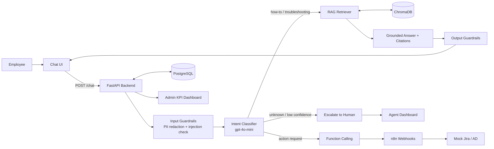

# AI-HAS Architecture

## Components
| Component | Tech | Role |
|---|---|---|
| Backend | FastAPI | Chat API, RAG orchestration, tool handlers |
| Vector DB | ChromaDB | SOP embeddings |
| Relational DB | PostgreSQL | Users, tickets, messages, audit logs |
| Automation | n8n | Ticket creation, password reset webhooks |
| LLM | gpt-4o-mini | Intent, answers, function calling |

## Request flow
1. Redact PII and check for prompt injection.
2. Classify intent.
3. Route: RAG answer, function call, or escalate.
4. Save message with citations, confidence, latency.
5. Return the answer (streamed).
