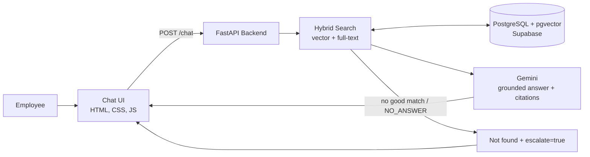
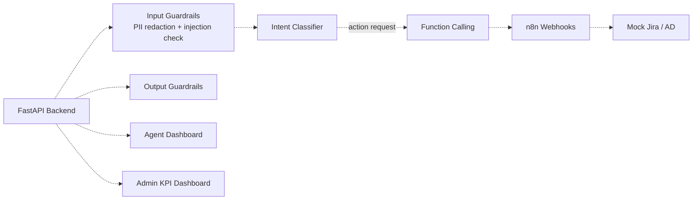

# AI-HAS Architecture

## What runs today

## Planned (not built yet)

## Components
| Component | Tech | Status | Role |
|---|---|---|---|
| Backend | FastAPI (Python 3.12) | Running | Chat API, RAG orchestration, serves the frontend |
| Frontend | Plain HTML, CSS, JS at `/static` | Running | Chat page, history kept in the browser |
| Database | PostgreSQL with pgvector on Supabase | Running | KB chunks and vectors; users, tickets, messages, audit logs tables defined |
| LLM | Gemini via OpenAI-compatible endpoint | Running | Embeddings and answers; model names come from `.env` |
| Local test DB | pgvector/pgvector Postgres, compose profile `local-db` | Running | Testing without touching Supabase |
| Automation | n8n | Planned | Ticket creation, password reset webhooks |
| Guardrails | PII redaction, injection checks | Planned | Input and output safety |
| Dashboards | Agent and admin views | Planned | Escalations and KPIs |

Docker compose runs one service today, `backend` (plus `db` under the `local-db` profile). There is no ChromaDB and no n8n container.

## Request flow (current)
1. Embed the question and run hybrid search over `kb_chunks` (vector distance plus full-text, merged by rank).
2. If the best distance is above 0.5, return the "not found" message with `escalate=true`.
3. Otherwise send the closest chunks to Gemini with a prompt that allows answers only from that context.
4. If the model replies NO_ANSWER, return "not found" with `escalate=true`. Else return the answer, citations and distances.

Messages, tickets and audit logs are not written yet.

## Database tables
`users`, `conversations`, `messages`, `tickets`, `kb_documents`, `kb_chunks`, `audit_logs`. See `backend/schema.sql`, which must be verified against the real Supabase definition.
